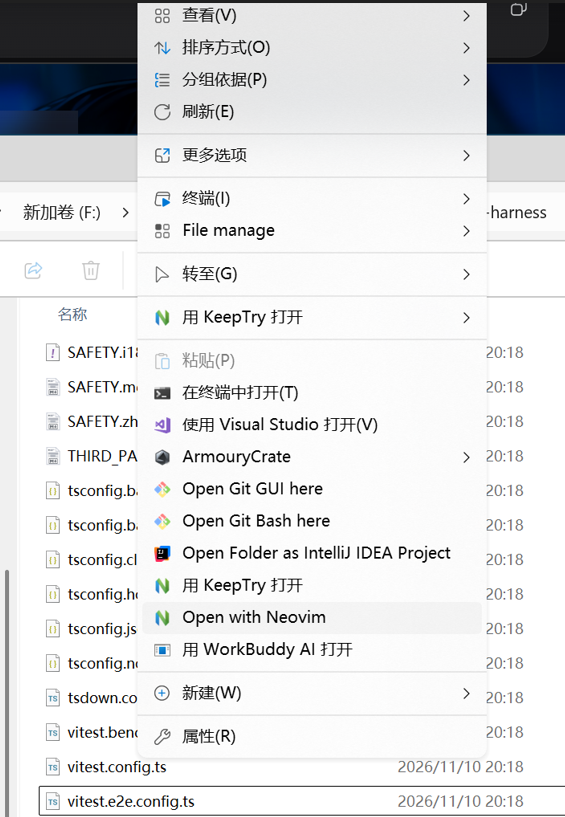

# nvim-context-menu

[](https://github.com/SimulationDuTe/nvim-context-menu/actions/workflows/powershell.yml)

Add **"Open with Neovim"** to the Windows Explorer right-click menu — for files, folders, and folder backgrounds. Opens in Windows Terminal when available.

- No admin rights (writes only `HKCU`)
- No hardcoded paths (nvim is resolved at run time)
- Works with a portable Neovim on any drive
- Optional top-level entry via [Nilesoft Shell](https://nilesoft.org)



## Quick start

```powershell
git clone https://github.com/SimulationDuTe/nvim-context-menu
cd nvim-context-menu
powershell -ExecutionPolicy Bypass -File install.ps1
```

By default it looks for `nvim.exe` in this order:

1. `-NvimExe` argument
2. `nvim.exe` on your `PATH`
3. `%LOCALAPPDATA%\Programs\Neovim\bin\nvim.exe`
4. `%ProgramFiles%\Neovim\bin\nvim.exe`
5. `C:\tools\neovim\nvim-win64\bin\nvim.exe`
6. `%USERPROFILE%\scoop\apps\neovim\current\bin\nvim.exe`
7. `%LOCALAPPDATA%\nvim\bin\nvim.exe`

If none is found, pass the path explicitly:

```powershell
powershell -ExecutionPolicy Bypass -File install.ps1 -NvimExe "D:\tools\nvim\bin\nvim.exe"
```

Custom menu text:

```powershell
powershell -ExecutionPolicy Bypass -File install.ps1 -Label "用 Neovim 打开"
```

## What it installs

| Item | Location |
|---|---|
| Launcher | `%LOCALAPPDATA%\nvim-context-menu\nvim-open.cmd` |
| Recorded nvim path | `%LOCALAPPDATA%\nvim-context-menu\nvim-path.txt` |
| Registry verbs | `HKCU\Software\Classes\*\shell\OpenWithNeovim`<br>`HKCU\Software\Classes\Directory\shell\OpenWithNeovim`<br>`HKCU\Software\Classes\Directory\Background\shell\OpenWithNeovim` |
| Nilesoft snippet (if installed) | appended to its `shell.nss` |

The launcher resolves nvim as: `PATH` → `nvim-path.txt` → `NVIM_EXE` environment variable. That is why moving your Neovim folder to another drive only needs a re-run of `install.ps1`, and why Explorer does not need a PATH refresh.

## Windows 11 note

Registry verbs always land in **"Show more options"** (Shift+F10), not in the new top-level menu. Microsoft removed no registry flag to change that; the top-level menu requires a COM `IExplorerCommand` extension.

For a **top-level** entry, install Nilesoft Shell (free, open source) and re-run the installer — it detects Nilesoft and appends a menu block automatically:

1. Download https://nilesoft.org/download (portable zip works)
2. Extract e.g. to `%LOCALAPPDATA%\Programs\Nilesoft Shell`
3. Elevated prompt: `shell.exe -register -restart`
4. `powershell -ExecutionPolicy Bypass -File install.ps1`

Use `-SkipNilesoft` if you do not want it to touch the Nilesoft config.

## Uninstall

```powershell
powershell -ExecutionPolicy Bypass -File uninstall.ps1
```

Removes the verbs, the launcher folder and the Nilesoft menu block. Neovim and Nilesoft Shell are left untouched.

## Limitations

- One file at a time (legacy shell verbs; multi-select triggers per file)
- Opens `.lnk` shortcuts as shortcuts, not their targets
- Requires Windows Terminal for a clean window; without it a console window flashes
- If you move Neovim to another drive, re-run `install.ps1` so the recorded path is updated

## 中文说明

把这个目录里的三个文件放到任意位置，然后：

```powershell
powershell -ExecutionPolicy Bypass -File install.ps1
```

脚本会自动找 `nvim.exe`（找不到就加 `-NvimExe 路径`），在桌面右键菜单里加「Open with Neovim」，默认在 Windows Terminal 里打开；传 `-Label "用 Neovim 打开"` 可以改成中文。

Win11 上这属于「显示更多选项」二级菜单；要一级菜单就先装 Nilesoft Shell（可选，脚本会自动识别并写入菜单配置）。卸载跑 `uninstall.ps1`，不影响 Neovim 本身。

## License

MIT — see [LICENSE](LICENSE).
